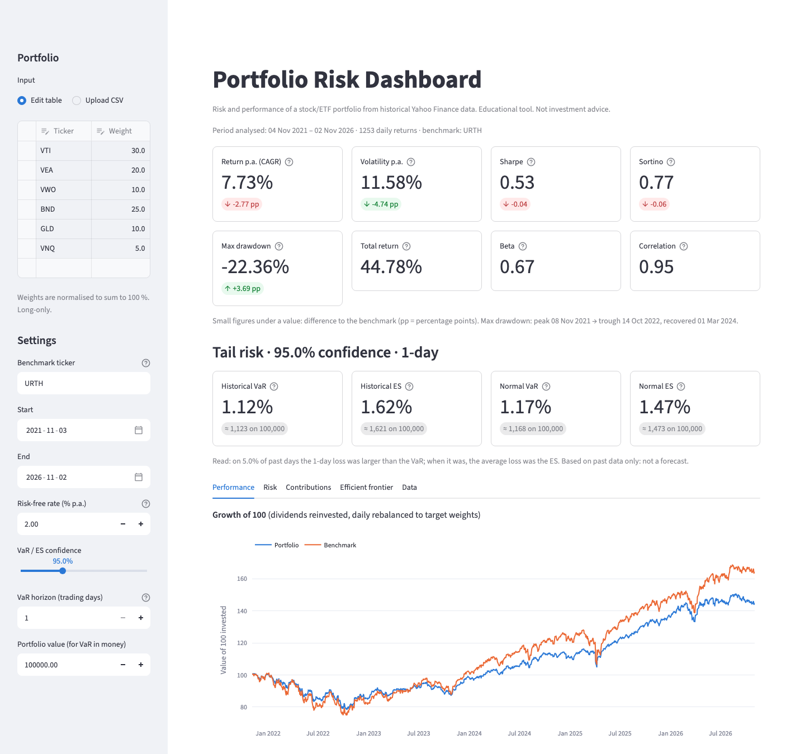

# portfolio-risk-dashboard

**A Streamlit web app that shows the risk and performance of a stock/ETF portfolio: return, volatility, Sharpe, Sortino, drawdown, beta, VaR and Expected Shortfall, risk contributions and an efficient frontier.**

[](https://github.com/robinrhs/portfolio-risk-dashboard/actions/workflows/ci.yml)


**Live demo:** _not deployed yet. The Streamlit Community Cloud link will go here (see [Deploy](#deploy-on-streamlit-community-cloud))._ <!-- TODO: paste the Streamlit Cloud URL after deploying -->



<sub>Screenshot of the app with the default portfolio and default settings (5 years to 2 Nov 2026, live Yahoo data), captured headlessly.</sub>

> Educational tool built on historical data. **Not investment advice**, not a forecast.

## What it does

Enter tickers and weights (or upload a CSV), choose a benchmark and a period, and the app:

- downloads daily adjusted close prices from Yahoo Finance (cached for 6 hours),
- reports **annualised return (CAGR)**, **volatility**, **Sharpe** and **Sortino** ratios, **max drawdown** with peak, trough and recovery dates, and **beta / correlation** to the benchmark,
- estimates **Value at Risk** and **Expected Shortfall**, both **historical** and **parametric (normal)**, for a 1-day horizon. Longer horizons are scaled with √time and labelled as an approximation,
- plots cumulative performance vs. benchmark, the drawdown curve, the return distribution with VaR thresholds and a correlation heatmap,
- splits **return and risk by position**: Euler risk contributions add up exactly to portfolio volatility,
- draws the long-only **mean-variance efficient frontier** with the minimum-variance and maximum-Sharpe portfolios.

Every metric has a short tooltip (the `?` icon) that explains it in plain English.

**Why:** the usual portfolio report shows weights and performance. Weights alone say little about risk. A 10 % position can carry 25 % of the risk if it is volatile and correlated with the rest. This dashboard puts weights, risk shares, tail risk and correlations on one screen.

## Quickstart

Requires [uv](https://docs.astral.sh/uv/) and Python ≥ 3.11.

```bash
git clone https://github.com/robinrhs/portfolio-risk-dashboard.git
cd portfolio-risk-dashboard
uv sync

uv run streamlit run streamlit_app.py      # the dashboard, opens http://localhost:8501
uv run portfolio-risk --help               # the same figures as a terminal report
uv run pytest                              # tests (offline, synthetic data)
```

The app opens with a diversified default portfolio (VTI 30 %, VEA 20 %, VWO 10 %, BND 25 %, GLD 10 %, VNQ 5 %) against the iShares MSCI World ETF (`URTH`), so it is useful straight away. An example CSV is in [`data/example_portfolio.csv`](data/example_portfolio.csv). Weights can be in any unit (percent, fractions or amounts of money); they are normalised to 100 % and the app tells you when it rescaled them. A weight must be a plain number (`50` or `0.5`): a value such as `50%`, `1,000` or `inf` stops with an error that names the ticker, and a ticker without a weight is left out with a note.

## Example output

Real output of the command-line report for the default portfolio, run on 2 Nov 2026 (`uv run portfolio-risk --start 2020-11-02 --end 2025-10-31`). Yahoo revises adjusted prices from time to time, so later runs can differ slightly in the last digits. The CLI uses the same `analyze()` call and the same input checks as the app (start before end, confidence between 0 and 1, at least 60 trading days) and exits with a one-line error otherwise.

```text
Period: 2020-11-03 to 2025-10-31 (1255 daily returns)
Weights: VTI 30.0%, VEA 20.0%, VWO 10.0%, BND 25.0%, GLD 10.0%, VNQ 5.0%

                              Portfolio  Benchmark
Total return                     0.6325     1.0508
Annualised return (CAGR)         0.1034     0.1551
Annualised volatility            0.1116     0.1617
Sharpe ratio                     0.7603     0.8503
Sortino ratio                    1.1122     1.2367
Max drawdown                    -0.2236    -0.2605
Beta to benchmark                0.6558          -
Correlation to benchmark         0.9505          -
Historical VaR (95.0% 1-day)     0.0106          -
Historical ES (95.0% 1-day)      0.0156          -
Parametric VaR (95.0% 1-day)     0.0111          -
Parametric ES (95.0% 1-day)      0.0141          -

Contributions (annualised):
     weight  return_contribution  risk_contribution  risk_share
VTI  0.3000               0.0503             0.0483      0.4329
VEA  0.2000               0.0258             0.0300      0.2690
VWO  0.1000               0.0088             0.0141      0.1261
BND  0.2500              -0.0002             0.0060      0.0534
GLD  0.1000               0.0158             0.0060      0.0538
VNQ  0.0500               0.0041             0.0072      0.0648

Max drawdown: peak 2021-11-08, trough 2022-10-14, recovery 2024-03-01
```

How to read it:

- **Bonds diversify risk.** BND is 25 % of the capital but only about 5 % of the risk. VTI is 30 % of the capital and 43 % of the risk.
- **Beta and correlation are different things.** The portfolio moves almost in lockstep with the MSCI World (correlation 0.95), but with only about two thirds of its amplitude (beta 0.66 = 0.95 × 11.2 % / 16.2 %).
- **The tail is fatter than the normal distribution assumes.** Historical ES (1.56 %) is above the normal ES (1.41 %), even though the two VaR figures are close.
- **√time is only an approximation.** With `--horizon 10` the same run prints a 10-day historical VaR of 3.36 % (1.06 % × √10). The historical VaR of the overlapping 10-day returns in this sample was 3.16 %, so here √time overstated the 10-day VaR slightly. Both figures are shown; neither is exact.

For the same period, the efficient-frontier tab puts the max-Sharpe portfolio at roughly 55 % GLD and 45 % VTI. That says more about gold's run in 2020–2025 than about the future. Mean-variance weights follow whatever performed best in the sample (see *Limitations*).

## Method

All maths lives in UI-free modules (`metrics.py`, `contributions.py`, `optimize.py`) and is tested against known answers. Notation: $r_t$ = daily simple return, $N = 252$ trading days per year, $w$ = weight vector, $\Sigma$ = covariance matrix.

| Metric | Formula | Notes |
|---|---|---|
| Daily return | $r_t = P_t / P_{t-1} - 1$ | adjusted close, so dividends are reinvested |
| Portfolio return | $r_{p,t} = \sum_i w_i\, r_{i,t}$ | constant weights = daily rebalancing |
| CAGR | $\left(\prod_t (1+r_t)\right)^{N/n} - 1$ | geometric, what an investor actually earned |
| Volatility | $\sigma = \operatorname{std}(r_t)\,\sqrt{N}$ | sample std (ddof = 1), √time scaling |
| Daily rate from annual | $r_d = (1+r_{annual})^{1/N} - 1$ | used for the risk-free rate and the MAR |
| Sharpe | $\dfrac{\overline{r_t - r_{f,d}}}{\operatorname{std}(r_t)}\sqrt{N}$ | constant risk-free rate |
| Downside deviation | $\sqrt{\tfrac{1}{n}\sum_t \min(r_t - \text{MAR}_d, 0)^2}\,\sqrt{N}$ | MAR = risk-free rate; mean over **all** days |
| Sortino | $\dfrac{(\bar r - \text{MAR}_d)\,N}{\text{DD}}$ | only penalises returns below the MAR |
| Drawdown | $D_t = W_t / \max_{s \le t} W_s - 1$, $W_t = \prod_{s\le t}(1+r_s)$ | starting capital counts as the first peak (then reported with the first return date) |
| Beta | $\beta = \operatorname{Cov}(r_p, r_b) / \operatorname{Var}(r_b)$ | overlapping dates only |
| Historical VaR | $\text{VaR}_c = -q_{1-c}(r)$ | empirical quantile, linear interpolation |
| Historical ES | $\text{ES}_c = -\operatorname{mean}(r_t \mid r_t \le q_{1-c})$ | average loss beyond VaR |
| Normal VaR | $\text{VaR}_c = z_c\,\sigma_d - \mu_d$ | $z_{0.95} = 1.645$, $z_{0.99} = 2.326$ |
| Normal ES | $\text{ES}_c = \sigma_d\,\varphi(z_c)/(1-c) - \mu_d$ | $\varphi$ = standard normal density |
| h-day scaling | $\text{VaR}_h \approx \text{VaR}_1\sqrt{h}$ | **approximation**, exact only for i.i.d. normal, zero-mean returns |
| h-day check | $\text{VaR}^{\text{overlap}}_h = -q_{1-c}\big(\prod_{s=t-h+1}^{t}(1+r_s) - 1\big)$ | historical VaR of overlapping h-day returns, shown next to the scaled figure; overlapping windows are not independent, so it is noisy |
| Return contribution | $w_i\,\bar r_i\,N$ | sums to the arithmetic mean return (not to CAGR) |
| Risk contribution | $RC_i = w_i\,(\Sigma w)_i / \sigma_p$ | Euler: $\sum_i RC_i = \sigma_p$ because $\sigma_p$ is homogeneous of degree 1 in $w$ |
| Min variance | $\min_w w^\top\Sigma w$ | s.t. $\sum w_i = 1$, $0 \le w_i \le 1$ |
| Max Sharpe | $\max_w (w^\top\mu - r_f)/\sqrt{w^\top\Sigma w}$ | same constraints, SLSQP |
| Frontier | $\min_w w^\top\Sigma w$ s.t. $w^\top\mu = \mu^*$ | $\mu^*$ from the min-variance return to the best single asset |

VaR and ES are shown as positive numbers (loss as a share of portfolio value) and, for convenience, in money for a portfolio value you choose.

### Data handling

- **Invalid or delisted tickers** (no data returned) are excluded with a warning; the remaining weights are rescaled to 100 %.
- **Non-overlapping histories:** the sample is cut to the period in which *all* positions and the benchmark have prices, and the app says which ticker caused the cut.
- **Gaps** of up to 5 trading days (e.g. different exchange holidays) are forward-filled, which means a 0 % return on those days. The number of filled prices is reported. Days that are still incomplete after that (a longer gap, e.g. a trading halt) are dropped, and the number of dropped days is reported too.
- **Currencies:** each ticker's quote currency is looked up. If they differ (e.g. `EUNL.DE` in EUR next to `VTI` in USD), the app warns that returns are in each asset's own currency **without FX conversion**.
- At least 60 overlapping trading days are required.

## Key assumptions

- Constant target weights, rebalanced daily at zero cost (constant-mix portfolio). Long-only.
- Constant annual risk-free rate (default 2 %), which is also the Sortino minimum acceptable return.
- Expected returns and covariances for the efficient frontier are the historical sample estimates of the chosen period.
- Returns are measured in each asset's quote currency; no FX conversion.

## Limitations

- **Historical data.** Every figure describes the chosen past period. Change the window and the numbers change, sometimes a lot. Past risk is a rough guide to future risk, past return almost none.
- **Normality assumption.** Parametric VaR/ES assume normally distributed returns. Real returns have fat tails and volatility clusters, so normal VaR tends to understate extreme losses. √time scaling ignores autocorrelation and changing volatility.
- **VaR is a threshold, not a worst case.** It says how often a loss was exceeded, not by how much. ES is better for that, but it is still estimated from a limited number of tail observations.
- **Survivorship bias.** You can only pick tickers that still exist today. Funds and companies that were delisted are missing, which flatters historical results.
- **No transaction costs, taxes or fees** beyond what is already in ETF prices. Daily rebalancing would be expensive in practice.
- **Mean-variance optimisation is very sensitive to expected returns.** Small changes in historical means move the max-Sharpe weights a lot (see the gold example above). The frontier illustrates the trade-off. It is not a recommended allocation.
- **Data source.** Yahoo Finance via the unofficial `yfinance` library: free, but without guarantees on availability, accuracy or terms of use. Not suitable for production use.
- **Currency mixes** are only detected and flagged, not converted.
- **Different exchanges close at different times.** For a portfolio that mixes exchanges (e.g. `EUNL.DE` next to `VTI`), news after the Frankfurt close shows up in the US price on the same day but in the German price only the next day. Forward-filled holidays add 0 % days. Both effects push measured correlations and beta towards zero and understate portfolio volatility. Weekly returns would reduce the effect; the app uses daily returns.

## Deploy on Streamlit Community Cloud

1. Push this repository to GitHub (public).
2. Go to [share.streamlit.io](https://share.streamlit.io), click **Create app**, pick the repository, branch `main` and main file **`streamlit_app.py`**.
3. Under *Advanced settings*, choose Python 3.12. No secrets are needed.
4. Deploy, then paste the app URL into the *Live demo* line at the top of this README.

Dependencies are pinned in `uv.lock`, and `requirements.txt` is exported from it (`uv export --format requirements-txt --no-dev --no-hashes --no-header -o requirements.txt`). CI fails if the two drift apart. `streamlit_app.py` also adds `src/` to the import path, so the app starts even if the package itself is not installed.

## Project structure

```text
portfolio-risk-dashboard/
├── streamlit_app.py              # entry point (local + Streamlit Community Cloud)
├── src/portfolio_risk/
│   ├── metrics.py                # return, volatility, Sharpe, Sortino, drawdown, beta, VaR/ES
│   ├── contributions.py          # return contributions, Euler risk contributions
│   ├── optimize.py               # efficient frontier, min-variance, max-Sharpe (scipy)
│   ├── portfolio.py              # input cleaning, weight normalisation, portfolio returns
│   ├── analysis.py               # one analyze() call used by app and CLI
│   ├── data.py                   # yfinance download, price cleaning, currency check
│   ├── charts.py                 # Plotly figures (no maths, no Streamlit)
│   ├── app.py                    # Streamlit layout and inputs
│   └── cli.py                    # `portfolio-risk` terminal report
├── docs/screenshot.png           # README screenshot
├── tests/                        # pytest: known-answer maths tests, CLI, AppTest of the full app
├── data/example_portfolio.csv    # example upload (ticker, weight)
├── .streamlit/config.toml        # theme
├── requirements.txt              # exported from uv.lock for Streamlit Cloud
└── .github/workflows/ci.yml      # ruff + pytest on Python 3.11 and 3.12
```

### Tests

`uv run pytest` runs offline. The maths tests use synthetic series with known answers: constant returns, series rescaled to an exact mean and volatility, a hand-computed drawdown and Sortino, VaR/ES on a uniform grid and on a large normal sample, risk contributions that must sum to volatility, and the closed-form two-asset minimum-variance and tangency portfolios. `analyze()` is checked on two assets where one moves exactly 3× the other, so beta, volatility and the risk contributions are known in closed form. The app test runs the real `streamlit_app.py` with `streamlit.testing.v1.AppTest` and replaces the Yahoo download with deterministic synthetic prices; it covers the default portfolio, invalid tickers, currency mixes, weight normalisation, the CSV upload, the 60-day minimum and the wording of the horizon caption. The CLI tests check the printed report and every error exit.

## License

[MIT](LICENSE) © 2026 Robin-Philip Rehschuh. Price data is not included in this repository; it is fetched from Yahoo Finance at runtime.
